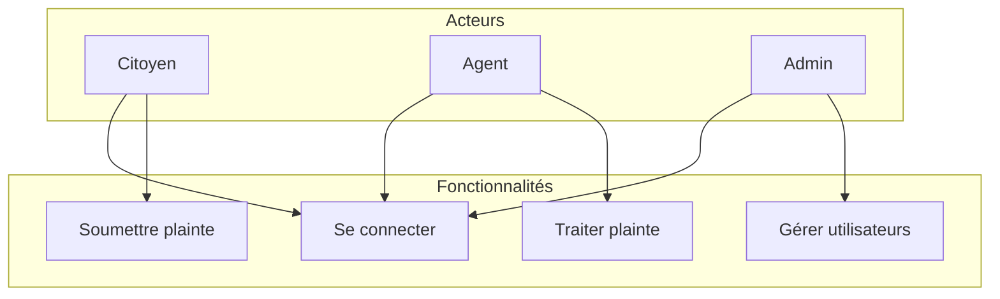
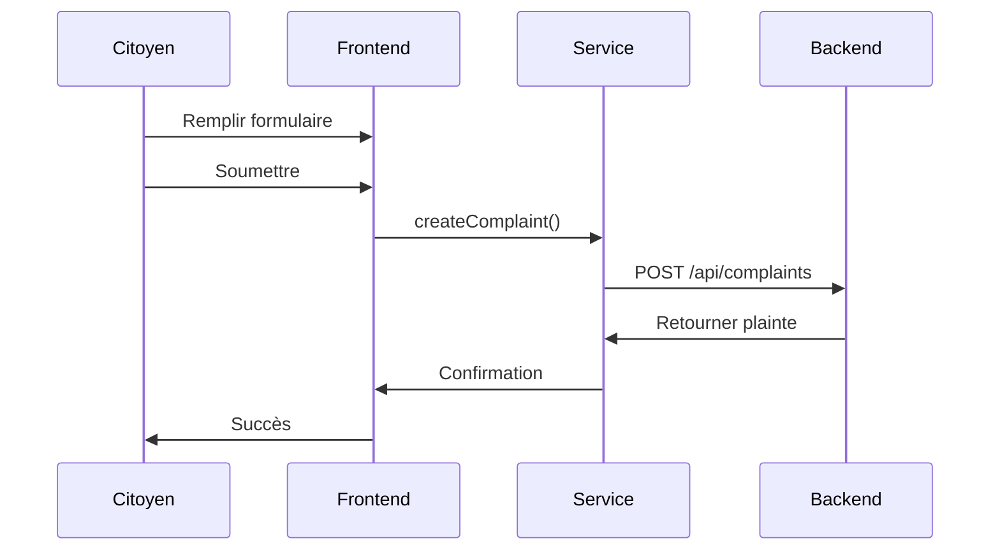
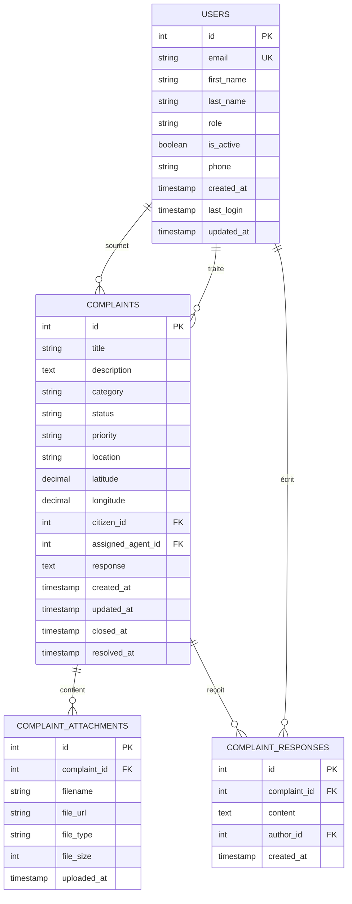

# Système de Gestion des Plaintes Citoyennes - Sénégal

## 📋 Vue d'ensemble

Application web Angular + Django pour la gestion des plaintes citoyennes au Sénégal.

## 👥 Acteurs

- **Citoyen**: Soumettre/consulter ses plaintes
- **Agent**: Traiter les plaintes assignées  
- **Administrateur**: Gestion complète du système

## 📊 Modèles de données

### User
```typescript
interface User {
  id: number;
  email: string;
  firstName: string;
  lastName: string;
  role: UserRole; // CITIZEN, AGENT, ADMIN
  isActive: boolean;
  createdAt: Date;
}
```

### Complaint
```typescript
interface Complaint {
  id: number;
  title: string;
  description: string;
  category: ComplaintCategory;
  status: ComplaintStatus;
  priority: ComplaintPriority;
  location: string;
  citizenId: number;
  assignedAgentId?: number;
  createdAt: Date;
  response?: string;
}
```

## 🔄 Cas d'utilisation



## ⏱️ Séquence - Soumission plainte



## 🗄️ Modélisation des données

### Diagramme Entité-Relation (ERD)



### Base de données

```sql
-- Users
CREATE TABLE users (
    id SERIAL PRIMARY KEY,
    email VARCHAR(255) UNIQUE NOT NULL,
    password_hash VARCHAR(255) NOT NULL,
    first_name VARCHAR(100) NOT NULL,
    last_name VARCHAR(100) NOT NULL,
    role VARCHAR(20) NOT NULL CHECK (role IN ('citoyen', 'agent', 'administrateur')),
    is_active BOOLEAN DEFAULT TRUE,
    phone VARCHAR(20),
    created_at TIMESTAMP DEFAULT CURRENT_TIMESTAMP,
    last_login TIMESTAMP,
    updated_at TIMESTAMP DEFAULT CURRENT_TIMESTAMP
);

-- Complaints  
CREATE TABLE complaints (
    id SERIAL PRIMARY KEY,
    title VARCHAR(255) NOT NULL,
    description TEXT NOT NULL,
    category VARCHAR(50) NOT NULL,
    status VARCHAR(20) NOT NULL DEFAULT 'soumise',
    priority VARCHAR(20) NOT NULL DEFAULT 'moyenne',
    location VARCHAR(255) NOT NULL,
    latitude DECIMAL(10, 8),
    longitude DECIMAL(11, 8),
    citizen_id INTEGER REFERENCES users(id),
    assigned_agent_id INTEGER REFERENCES users(id),
    response TEXT,
    created_at TIMESTAMP DEFAULT CURRENT_TIMESTAMP,
    updated_at TIMESTAMP DEFAULT CURRENT_TIMESTAMP,
    closed_at TIMESTAMP,
    resolved_at TIMESTAMP
);

-- Complaint Attachments
CREATE TABLE complaint_attachments (
    id SERIAL PRIMARY KEY,
    complaint_id INTEGER REFERENCES complaints(id) ON DELETE CASCADE,
    filename VARCHAR(255) NOT NULL,
    file_url VARCHAR(500) NOT NULL,
    file_type VARCHAR(100),
    file_size INTEGER,
    uploaded_at TIMESTAMP DEFAULT CURRENT_TIMESTAMP
);

-- Complaint Responses
CREATE TABLE complaint_responses (
    id SERIAL PRIMARY KEY,
    complaint_id INTEGER REFERENCES complaints(id) ON DELETE CASCADE,
    content TEXT NOT NULL,
    author_id INTEGER REFERENCES users(id),
    created_at TIMESTAMP DEFAULT CURRENT_TIMESTAMP
);

-- Index pour optimiser les performances
CREATE INDEX idx_complaints_citizen_id ON complaints(citizen_id);
CREATE INDEX idx_complaints_assigned_agent_id ON complaints(assigned_agent_id);
CREATE INDEX idx_complaints_status ON complaints(status);
CREATE INDEX idx_complaints_category ON complaints(category);
CREATE INDEX idx_complaints_created_at ON complaints(created_at);
```

## 🚀 Technologies

- **Frontend**: Angular 17, TypeScript
- **Backend**: Django, Python
- **Base**: PostgreSQL
- **Auth**: JWT
