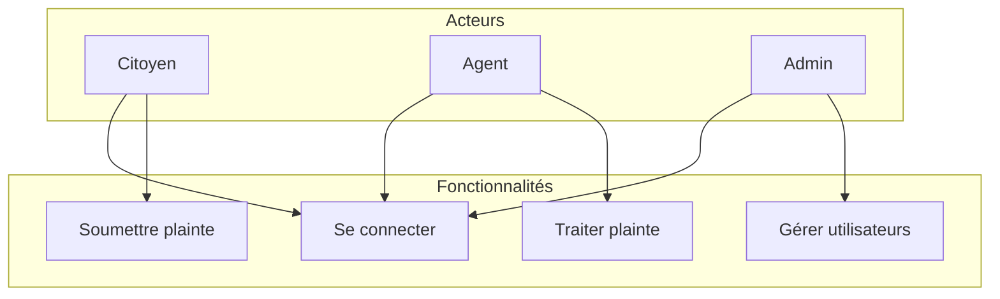
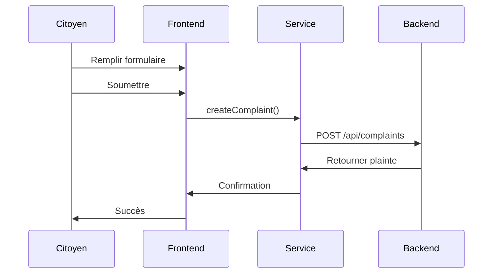

# Système de Gestion des Plaintes Citoyennes - Sénégal

## 📋 Vue d'ensemble

Application web Angular + Django pour la gestion des plaintes citoyennes au Sénégal.

## 👥 Acteurs

- **Citoyen**: Soumettre/consulter ses plaintes
- **Agent**: Traiter les plaintes assignées  
- **Administrateur**: Gestion complète du système

## 📊 Modèles de données

### User
```typescript
interface User {
  id: number;
  email: string;
  firstName: string;
  lastName: string;
  role: UserRole; // CITIZEN, AGENT, ADMIN
  isActive: boolean;
  createdAt: Date;
}
```

### Complaint
```typescript
interface Complaint {
  id: number;
  title: string;
  description: string;
  category: ComplaintCategory;
  status: ComplaintStatus;
  priority: ComplaintPriority;
  location: string;
  citizenId: number;
  assignedAgentId?: number;
  createdAt: Date;
  response?: string;
}
```

## 🔄 Cas d'utilisation



## ⏱️ Séquence - Soumission plainte



## 🗄️ Base de données

```sql
-- Users
CREATE TABLE users (
    id SERIAL PRIMARY KEY,
    email VARCHAR(255) UNIQUE,
    role VARCHAR(20),
    created_at TIMESTAMP
);

-- Complaints  
CREATE TABLE complaints (
    id SERIAL PRIMARY KEY,
    title VARCHAR(255),
    status VARCHAR(20),
    citizen_id INTEGER REFERENCES users(id),
    assigned_agent_id INTEGER REFERENCES users(id)
);
```

## 🚀 Technologies

- **Frontend**: Angular 17, TypeScript
- **Backend**: Django, Python
- **Base**: PostgreSQL
- **Auth**: JWT
